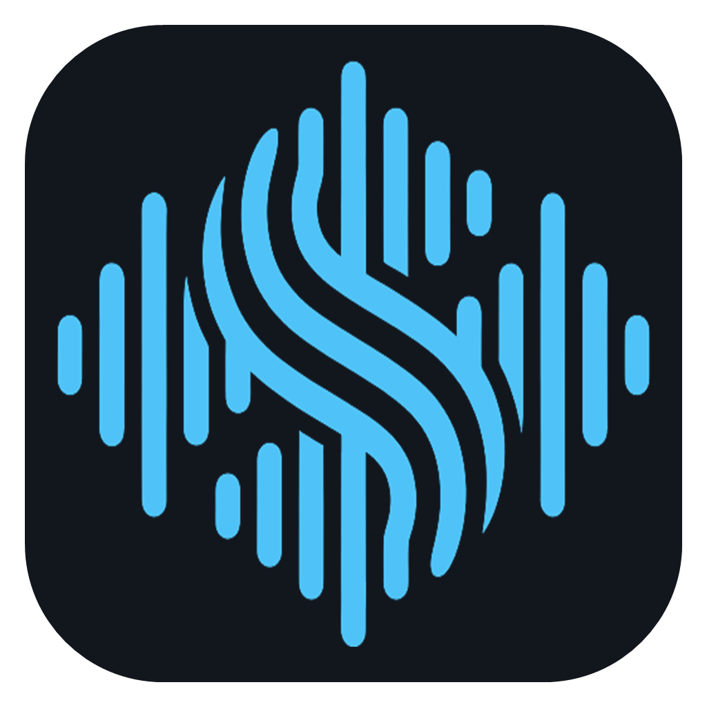

  
  <h1>SRNZ Audio</h1>
  
<strong>VST3 &amp; Standalone Audio Instruments, Effects, and Studio Tools</strong>

---

## About

**SRNZ Audio** builds modern audio synthesizers, samplers, spectral processors, dynamic mix tools, and DAW utilities. Our plugin suite is developed in C++17/C++20 with **JUCE 8** and designed around a unified dark-glassmorphism interface language, paired with specialized REAPER workflow tools.

---

## VST3 & Standalone Plugin Suite

| Plugin | Category | Overview |
| :--- | :--- | :--- |
| **AtomSmasher** | Sampler & Modular FX | Multi-layer sample synthesizer with YIN pitch tracking, loop crossfading, visual ADSR, and 10-slot modular FX chain. |
| **BoomBox** | Drum & Sub-Bass Synth | 808/909 kick and snare synthesis with multi-range keyboard mapping and real-time waveform visualizer. |
| **ChanRack** | Modular Channel Strip & FX Rack | Dynamic multi-instance FX rack pulling all 19 shared processors with external sidechain routing and A/B compare. |
| **FilTerse** | Dynamic Resonant Filter & FX | 6-model resonant filter core (SVF, 303, Moog, MS-20, Formant, Comb), 2D/3D XY pad, 5-tile serial FX rack, and 12 LFOs. |
| **Fuze** | Granular Texture Synth & Resonator | 32-voice granular engine, 8 procedural models, 8-voice tuned comb bank, and sidechain beat sync. |
| **Nexus8** | Guitar Widener, Sub Bass & Harmonizer | 4/6/8-voice stereo replica generator, YIN pitch-tracked sub bass, and polyphonic WSOLA MIDI harmonizer. |
| **OranjCrush** | FM Drum Synth & Glitch FX | Audio-rate Cross-FM & Ring Mod synth, MS-20 ESP, 8x8 pin matrix, Aphex drill ratcheting, and breakbeat slicer. |
| **ProFlyer** | Spectral Match & Profiling EQ | Dual-engine (zero-latency biquad & 2048-tap linear-phase FIR) spectral matching equalizer with live capture. |
| **PulseDrift** | Generative Beat & Rhythm Engine | 6-lane hybrid rhythm matrix, 4-way Linkwitz-Riley crossover, 10 Kinetic FX, and Perlin organic drift LFOs. |
| **QBaller** | Quantum Sample Quantizer & Synth | Transient & YIN harmonic tracking, Relocate/TimeWarp/PitchWarp sculpting, slip-wave loop editing, and 88-key playback. |
| **StanzaLab** | Speech-to-Music Mini-DAW | Transforms spoken poetry/prose into evolving electronic music with 5-engine synth suite, piano roll, and stem export. |
| **SubTrakt** | Dynamic Multiband Unmasker | Sidechain unmasker and dynamic EQ / multiband splitter with 3-mode real-time spectrum visualizer. |
| **TapOut** | Multi-Tap Delay & Sequencer | Rhythmic multi-tap delay with interactive pattern sequencer, warp/pitch sweep, and real-time tap visualizer. |

---

## REAPER & Studio Tools

- **DM-Beatdown** — Floating **ReaImGui** metal drum beat palette for REAPER alongside a browser-based Web Studio step sequencer and MIDI exporter.

---

## Ecosystem & Architecture

- **`srnz-suite`** — Umbrella workspace, shared build automation, and submodule integration for all 13 VST3/Standalone plugins.
- **`srnz-shared`** — Shared header-only JUCE 8 UI controls and the 19-processor modular `Effects` DSP library.
- **`srnz-brand`** — Master vector/raster emblems, application badges, taskbar icons, and visual design specifications.
- **`srnz-tools`** — Internal QA utilities and standalone `EffectsTester` sandbox for DSP auditioning.

> *Note: Source repositories are currently private while in active development.*
